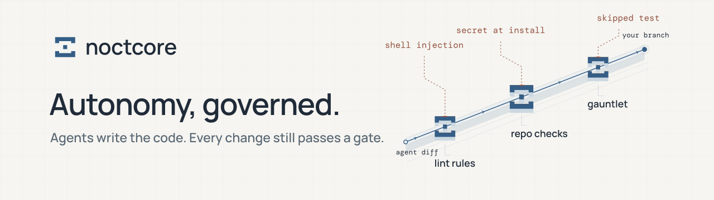

<div align="center">
  <picture>
    <source media="(prefers-color-scheme: dark)" srcset="assets/brand/readme-header-dark.svg">
    <source media="(prefers-color-scheme: light)" srcset="assets/brand/readme-header-light.svg">
    
  </picture>

  <p><strong>The source of <a href="https://noctcore.github.io/">noctcore.github.io</a>, the home page of the noctcore organization.</strong></p>
</div>

## What it is

One static page: what noctcore is, the two desktop apps, an index of every npm package with its install line, and a set of drawings that follow one change through the gates. It is plain HTML, CSS and a little JavaScript, built by one Node script with no dependencies.

## Build

Needs Node 22 or later.

```sh
node scripts/build.mjs
```

This writes the site to `dist/` and a single self-contained `preview.html` you can open straight from disk. To view `dist/` with its fonts, serve it over HTTP, for example `python3 -m http.server 4321 --directory dist`.

## Layout

| Path | What it holds |
| --- | --- |
| `src/data.json` | Apps, package families, versions and links. Change facts here. |
| `scripts/sheets.mjs` | The five drawing sheets: route, steps and what each step stops. |
| `scripts/diagram.mjs` | The marks and the drawing forms (passage, ledger, the hero plan). |
| `scripts/build.mjs` | The page template and the build into `dist/`. |
| `src/site.css`, `src/site.js` | Styles for both themes, and the theme switch, copy buttons and sheet controls. |
| `src/fonts/` | Manrope and DM Mono, subset to Latin, with their OFL licenses. |

The build fails if any em or en dash slips into the page.

## Deploy

Every push to `main` builds and deploys to GitHub Pages through `.github/workflows/pages.yml`.

## License

MIT for the code. The fonts are under the SIL Open Font License, see `src/fonts/`.
